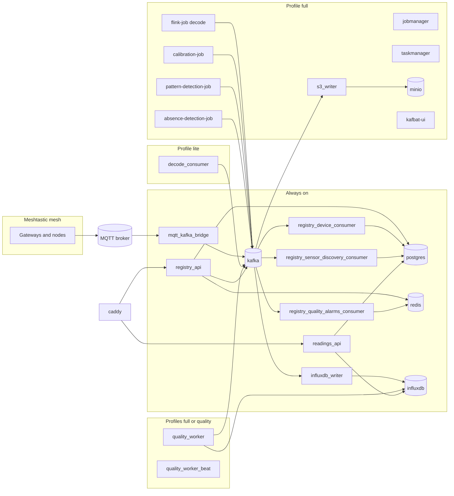

# Architecture

All services are declared in Compose files under `compose/`, included from `docker-compose.yml`. Production binds only loopback except Caddy (`80`/`443`). `docker-compose.dev.yml` publishes admin UIs and switches Django to `dev` settings.

## Profiles

| Profile | File | Effect |
| --- | --- | --- |
| default (always on) | `base.yml`, `api.yml`, `pipeline.yml`, `gateway.yml` | Kafka, Postgres, Redis, InfluxDB, APIs, MQTT bridge, Influx writer, Caddy |
| `lite` | `pipeline.yml` | Python `decode_consumer` instead of Flink |
| `full` | `pipeline.yml`, `flink.yml`, `gateway.yml`, `quality.yml` | Flink jobs, MinIO, S3 writer, kafbat-ui, quality worker |
| `quality` | `quality.yml` | Batch worker on a lite stack |
| `bridge-pool` | `pipeline.yml` | Extra MQTT bridge replicas (`mqtt_kafka_bridge_2`, `_3`) |

`lite` and `full` are alternatives for decode: do not run both at once or they will compete for the same raw topic.

## Service map

Caddy is the public entry point. `/readings/*` goes to `readings_api`; everything else, including `/schema` and `/docs`, goes to `registry_api`.

## Services

### Data plane (always)

| Service | Image / build | Role |
| --- | --- | --- |
| `kafka` | `apache/kafka` | Event bus. Topics created by `kafka-topics-init` |
| `postgres` | `postgres:16-alpine` | Registry of owners, meshes, devices, catalog |
| `redis` | `redis:7-alpine` | Cache, sessions, alarm-email windows (AOF persisted) |
| `influxdb` | `influxdb:2.7` | Time-series store |

### Ingest and writers

| Service | Profile | Role |
| --- | --- | --- |
| `mqtt_kafka_bridge` | always | MQTT shared subscription → `mesh.telemetry.raw.v1` |
| `mqtt_kafka_bridge_2/3` | `bridge-pool` | Extra share-group members |
| `decode_consumer` | `lite` | Decrypt/decode raw packets in Python |
| `influxdb_writer` | always | Decoded events + alarms → InfluxDB |
| `s3_writer` | `full` | Decoded events → hourly Parquet partitions |
| `minio` | `full` | S3-compatible bucket |

### APIs and catalog consumers

The API image is built from `meshtastic_things/api/Dockerfile`. Role is selected with `APP_ROLE`.

| Service | APP_ROLE | Role |
| --- | --- | --- |
| `registry_api` | `registry` | Mutating API, migrations, seeding, OpenAPI. Publishes compact key/config topics |
| `readings_api` | `readings` | Read-only Postgres role `readings_ro` (no PSK columns) plus Influx queries |
| `registry_device_consumer` | `registry` | `mesh.devices.v1` → upsert `devices` |
| `registry_sensor_discovery_consumer` | `registry` | `mesh.sensor_discovery.v1` → variants and measurements |
| `registry_quality_alarms_consumer` | `registry` | `mesh.telemetry.alarms.v1` → owner emails and summaries |

### Stream processing (full)

Flink cluster plus one-shot submit containers (`restart: "no"`) that upload named jobs.

| Service | Job name | Role |
| --- | --- | --- |
| `jobmanager` / `taskmanager` | — | Flink runtime |
| `flink-job` | `mesh-decode-decrypt` | Decode/decrypt (replaces `decode_consumer`) |
| `calibration-job` | `mesh-calibration` | Per-field calibration from `mesh.calibration.v1` |
| `pattern-detection-job` | `mesh-pattern-detection` | `flat_value` and `range` on calibrated points |
| `absence-detection-job` | `mesh-absence-detection` | Device silence vs publish interval |

### Batch quality (full or `quality`)

| Service | Role |
| --- | --- |
| `quality_worker` | Celery worker: blueprints over a lookback window, completeness/gap analysis |
| `quality_worker_beat` | Schedules `scan_devices` (default every hour) |

The worker authenticates to the registry as a superuser so it can see every owner's devices.

### Gateway

| Service | Profile | Role |
| --- | --- | --- |
| `caddy` | always | TLS, routing, basic-auth for admin UIs |
| `kafbat-ui` | `full` | Kafka topic browser |
| `mailhog` | dev overlay | Local SMTP catcher |

Admin UIs (Flink, Kafka UI, InfluxDB, MinIO) are reversed by Caddy on `CADDY_*_ADDRESS` and gated with credentials from `caddy/credentials/`.

## Kafka topics

Created by `kafka-topics-init`. Compact topics hold the current config; the rest are a log.

| Topic (env default) | Policy | Producers | Consumers |
| --- | --- | --- | --- |
| `mesh.telemetry.raw.v1` | log | MQTT bridge | decode_consumer or Flink decode |
| `mesh.telemetry.rawhealth.v1` | log | MQTT bridge | (health) |
| `mesh.telemetry.decoded.v1` | log | decode / Flink decode | Influx writer, S3 writer, calibration |
| `mesh.telemetry.calibrated.v1` | log | Flink calibration | pattern detection |
| `mesh.telemetry.alarms.v1` | log | pattern/absence jobs, quality worker | Influx writer, alarm email consumer |
| `mesh.devices.v1` | log | decode path | device consumer |
| `mesh.sensor_discovery.v1` | log | decode path | sensor discovery consumer |
| `mesh.keys.v1` | compact | registry_api | decode (PSK / mesh id by gateway) |
| `mesh.node_rejections.v1` | compact | registry_api | decode (drop disallowed nodes) |
| `mesh.quality_config.v1` | compact | registry_api | Flink detectors |
| `mesh.calibration.v1` | compact | registry (when calibration is configured) | Flink calibration |

## Decode path

Decode (Python or Flink) reads compact `mesh.keys.v1` keyed by gateway id and `mesh.node_rejections.v1`. A packet whose gateway is unknown, or whose node is rejected, is dropped. Allowed packets become JSON with `mesh_id`, `node_id`, `payload_kind`, and `payload`.

Sightings and discovery events are emitted so Postgres stays aligned with what actually appears on the mesh, without the API having to poll MQTT.

## Postprocessing blueprints

A `PostprocessingBlueprint` is an ordered list of named algorithms (`common/algorithms`). Each step binds inputs to channel names (`measurement.field`), optional params, and output channel names.

The batch executor:

1. Loads required Influx channels over `QUALITY_WORKER__BLUEPRINT_LOOKBACK` (default 7 days).
2. Aligns series to the device reading interval (tolerance 0.5 interval).
3. Runs steps in order; later steps can consume earlier outputs.
4. Writes results to the Influx measurement `derived`, tagged with `blueprint_id`.

Pointwise algorithms are intended to be runnable per sample; windowed algorithms stay on the batch tier.

## Django settings

Set `DJANGO_SETTINGS_MODULE` to `api_project.settings.dev` or `api_project.settings.prod`, never to the `settings` package itself. `APP_ROLE` is `registry` or `readings`. Both roles must share the same `SECRET_KEY` so session cookies issued by registry decode on readings.
