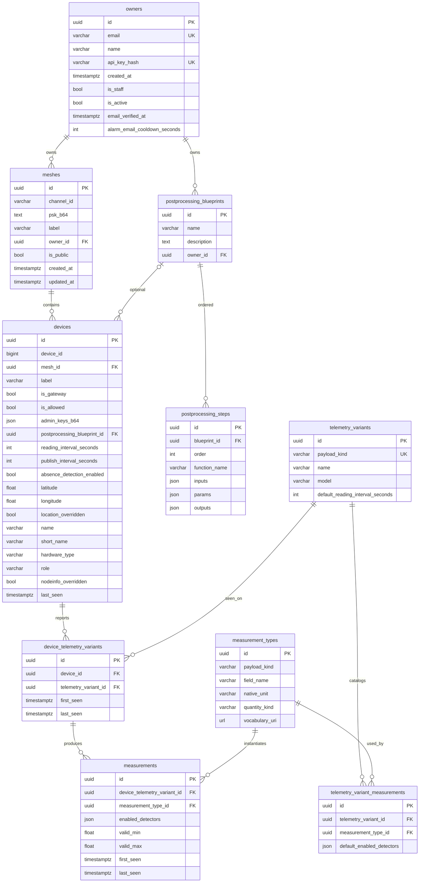

# Data model

Three stores hold product data:

- **PostgreSQL** — fleet registry (this schema).
- **InfluxDB** — points and alarms.
- **Parquet on S3/MinIO** — decoded-event archive (full profile).

The canonical Postgres layout is also in [data-model.dbml](data-model.dbml) (dbdiagram.io / `dbml` CLI).

## PostgreSQL (registry)

Django app `registry`. Primary keys are UUIDs unless noted. Auth user model is `owners`.

### Tables

**owners** — Account. API access is `Authorization: Bearer` against `api_key_hash` (SHA-256 of a key shown once). Password is used for session login and the Django admin. `is_active` is email-verified. `alarm_email_cooldown_seconds` overrides the server default for that owner; null means use `REGISTRY__ALARM_EMAIL_COOLDOWN_SECONDS`.

Visibility: a verified owner reads their meshes and any `meshes.is_public`. Superusers read everything. Writes never follow `is_public`; only the mesh owner (or a superuser) may change a mesh.

**meshes** — One physical Meshtastic network. `channel_id` plus `psk_b64` are published on compact `mesh.keys.v1` so decode can decrypt. The readings role is granted only `id`, `owner_id`, `is_public` on this table (no PSK).

**devices** — Gateway or node. `device_id` is the Meshtastic node number. At most one *allowed* row may exist for a given `device_id` (`uq_devices_device_id_allowed`). `is_allowed = false` is how a node is rejected; that fact is published on `mesh.node_rejections.v1`. NodeInfo and position can fill name/location unless `*_overridden` is set.

**postprocessing_blueprints / postprocessing_steps** — Owner-scoped recipe. Unique `(owner, name)` and `(blueprint, order)`. `function_name` must exist in `common.algorithms`. A device may point at one blueprint (`ON DELETE SET NULL`).

**telemetry_variants** — A Meshtastic Telemetry protobuf variant (`payload_kind` like `telemetry:environment_metrics`) or a fixed device/computed kind (`device:position`, `computed:derived`, …).

**measurement_types** — One physical quantity: `(payload_kind, field_name)` unique. `quantity_kind` is `physical_property | concentration | count | ratio | other`. Optional QUDT/EIONET `vocabulary_uri`.

**telemetry_variant_measurements** — Catalog: this variant produces this quantity. `default_enabled_detectors` is the per-channel default until a device measurement overrides it.

**device_telemetry_variants** — Auto-created when that variant is first seen on the device. Unique `(device, telemetry_variant)`.

**measurements** — The live channel on a device. `enabled_detectors`: `null` inherits the catalog default, `[]` disables detectors on that channel. `valid_min` / `valid_max` are set together for the range detector; both null skips range.

Django also keeps `django_session` so a browser cookie from registry authenticates on readings. `auth_group` / `auth_permission` come from `PermissionsMixin`.

### Cardinality notes

- Owner 1—* Mesh, Owner 1—* Blueprint.
- Mesh 1—* Device (a device belongs to one mesh).
- Device *—0..1 Blueprint.
- Device *—* TelemetryVariant via `device_telemetry_variants`.
- TelemetryVariant *—* MeasurementType via `telemetry_variant_measurements`.
- DeviceTelemetryVariant 1—* Measurement, each measurement pointing at one MeasurementType.

## InfluxDB

Bucket from `INFLUX__BUCKET` (default `telemetry`). A **channel** is `measurement.field`, matching blueprint bindings and quality-config keys.

`payload_kind` is always `namespace:measurement`. The measurement half is the Influx measurement name.

| Namespace | Measurement | Origin | Typical fields |
| --- | --- | --- | --- |
| `telemetry` | protobuf variant name (`environment_metrics`, `device_metrics`, …) | measured | numeric leaves of that sub-message |
| `device` | `position` | device | `latitude`, `longitude`, `altitude` |
| `device` | `nodeinfo` | device | `user_id`; tags `long_name`, `short_name`, `hw_model`, `role` |
| `computed` | `derived` | computed | blueprint outputs; tag `blueprint_id` |
| `computed` | `quality` | computed | completeness / gap metrics |
| `computed` | `alarms` | computed | `message`, optional `value` |

Common tags on telemetry points: `mesh_id`, `node_id`, optional `channel_id`, `gateway_id`. Metadata fields on every point: `packet_id`, `timestamp_quality` (`rx_time` or `payload`). Alarm points use tags `detector`, `mesh_id`, `node_id`, optional `channel`, `source` (`stream` or `batch`).

TEXT_MESSAGE_APP and ROUTING_APP (`device:portnum_1`, `device:portnum_5`) are not written.

## Parquet archive (full)

Prefix `S3_WRITER__PREFIX` (default `telemetry`). One object per mesh and UTC hour:

`{prefix}/mesh_id={uuid|unknown}/dt={YYYY-MM-DD}/hour={HH}/data.parquet`

| Column | Type |
| --- | --- |
| `node_id` | int64 |
| `packet_id` | int64 |
| `portnum` | int64 |
| `rx_time` | int64 |
| `hop_start` | int64 |
| `channel_id` | string |
| `gateway_id` | int64 |
| `payload_kind` | string |
| `payload_json` | string (JSON of the decoded payload) |

Rows are deduplicated on `(node_id, packet_id, rx_time, payload_kind)` when a partition is rewritten.

## Redis

Not a domain model, but it holds:

- Django cache / sessions (registry db 0, readings db 1).
- Celery broker for the quality worker (db 2).
- Alarm email windows: sorted set `registry:alarm-windows` and hashes `registry:alarm-held:{mesh}:{device}`.
